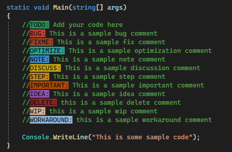

#  **Highlighter**

 [](https://github.com/AIDK/Highlighter/blob/main/LICENSE.txt)

A Visual Studio extension for C# and C/C++ that highlights keywords in comments, so they stand out while you work.

Works with **Visual Studio 2019, 2022 and 2026** (Community, Professional and Enterprise).



# Installation
- **Marketplace:** in Visual Studio, go to **Extensions** > **Manage Extensions** and search for *Highlighter*.
- **Manual:** download `Highlighter.vsix` from the [latest release](https://github.com/AIDK/Highlighter/releases/latest), close Visual Studio and run the file.

# Usage
Start a comment with one of the keywords below, followed by a colon:

```csharp
// TODO: handle the empty case
// BUG: this throws when the list is empty
// CHECK: confirm the timeout value
```

# Supported keywords
| Keyword | Default color |
| --- | --- |
| **IDEA** | Purple |
| **TODO** | Green |
| **BUG** | Red |
| **NOTE** | Blue |
| **DISCUSS** | Yellow |
| **OPTIMIZE** | Water green |
| **FIXME** | Deep orange |
| **STEP** | Orange/yellow |
| **IMPORTANT** | Orange |
| **DELETE** | Lightish red |
| **WIP** | Peach |
| **WORKAROUND** | Light blue |
| **CHECK** | Pink |

You can change the colors by going to **Tools** > **Options** > **Environment** > **Fonts and Colors** and looking for the entries that start with **Highlighter -**.

The list of keywords is currently fixed.

# Building
Open `Highlighter.sln` in Visual Studio 2022 or later (with the *Visual Studio extension development* workload) and build the **Release** configuration. The package is written to `Highlighter/bin/Release/Highlighter.vsix`. Press F5 to start the experimental instance for debugging.

# Credits
Credit to: [HumanGamer](https://github.com/HumanGamer/TODOHighlighter) for all the heavy lifting
